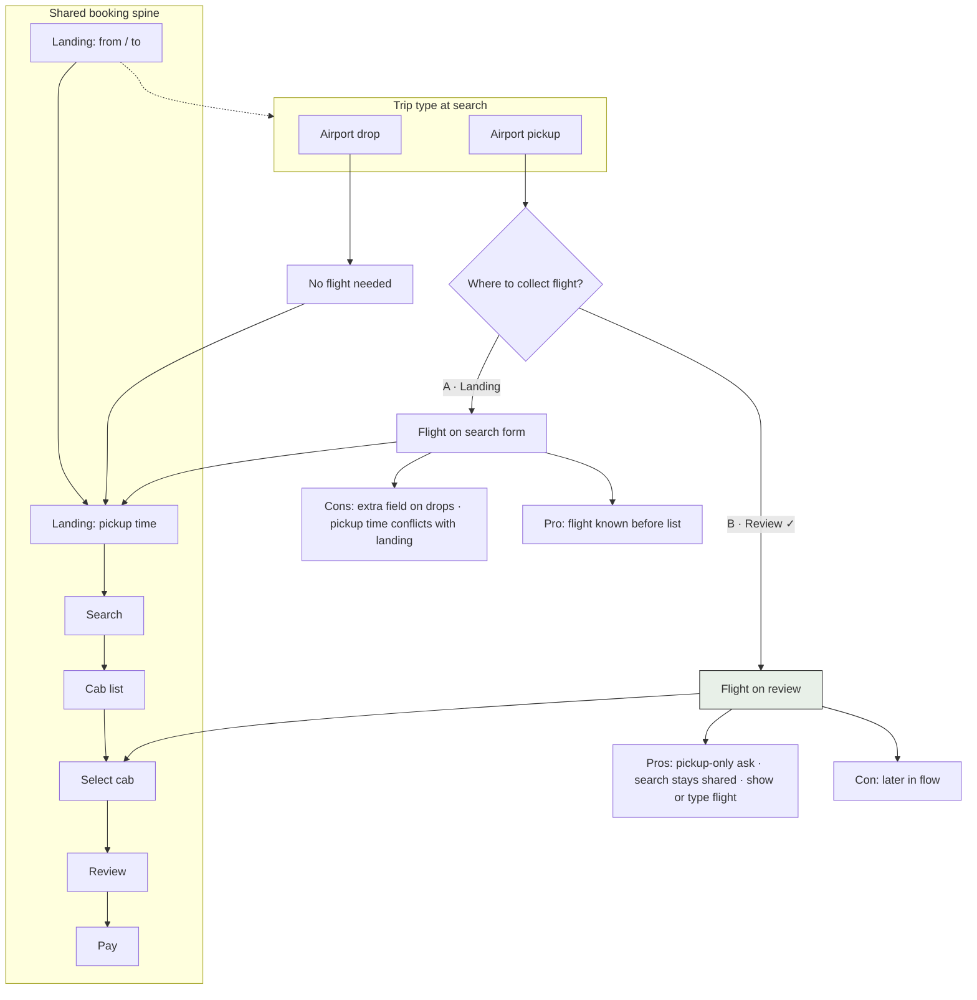

# Where to collect the flight — working draft

**Purpose:** Ideate and narrate the **flight-number touchpoint** decision before editing `AirportCaseStudy.astro`.  
**Pairs with:** `airport-pickups.content.md` (full case).  
**Section `id` on site:** `touchpoint`

---

## What the reader should take away

1. The **baseline booking path** did not ask for a flight at all—pickup time was fixed at search.
2. **Flight Tracked Cab** needs a flight on the booking—but only for **airport pickup**, not airport drop.
3. Two realistic places to ask: **landing (search)** vs **review (before pay)**.
4. We chose **review** because search must stay simple for every trip type, and pickup time on the landing form still means something for non–flight-tracked cabs.

---

## Baseline flow (before flight collection)

| Step | Screen | What the user does |
|------|--------|-------------------|
| 1 | Landing | Opens airport cab search |
| 2 | Landing | Fills **from** and **to** |
| 3 | Landing | Picks **cab pickup time** |
| 4 | Landing | Taps **search** |
| 5 | Cab list | Sees cabs for the trip |
| 6 | Cab list | Selects preferred cab |
| 7 | Review | Reads policies, confirms trip |
| 8 | Pay | Completes payment |

**Gap:** No flight on the booking. Cab time never updates when the flight moves.

---

## New requirement

Collect **flight details** so ops and the product can tie pickup to **landing time** (Flight Tracked Cab).

**Constraint:** Flight is required for **pickup from airport** (meet the traveller after landing). It is **not** required for **drop to airport** (leave home/office on a schedule the user already controls).

---

## Parallel touchpoints (the decision)

Both options share the same spine after search. The fork is **where** the flight field appears.

### Option A — Landing page (search form)

**When:** User has set from/to and pickup time, before search.

| Pros | Cons |
|------|------|
| Flight known before cab list—could theoretically rank or filter | Every **airport drop** still sees a field they do not need |
| Feels “complete” before results | **Pickup time** on landing becomes misleading for flight-tracked trips—the meaningful time is landing, not what they tapped |
| | Heavier form for the majority who book a normal timed cab |
| | Mixes two mental models on one screen: “when I want the cab” vs “which flight I am on” |

### Option B — Review page (before pay) ✓ **Shipped**

**When:** User has chosen a cab (including Flight Tracked Cab), on review with policies.

| Pros | Cons |
|------|------|
| Ask only on the path where flight matters (pickup + tracked product) | Later in the funnel—some users only discover the ask at review |
| Landing stays one form for **pickup and drop** | If we do not know their flight from elsewhere, they must enter it under time pressure |
| **Pickup time** on search still means “when the cab should come” for standard cabs | |
| Commitment moment: user already chose Flight Tracked Cab | |
| Can **show** flight if MakeMyTrip already has it from a prior booking | |

**Decision:** **Review** keeps search honest for drops and keeps pickup time meaningful for non-tracked cabs. List + review together carry the story: one SKU on the list, confirm or add flight on review.

---

## Single flowchart (source of truth for the page diagram)

Copy into any Mermaid viewer to iterate. The live site renders this structure in `FlightTouchpointFlow.astro` (HTML/CSS, no runtime).

**Note for narrative:** Option A feeds back into pickup time on the spine (we did not ship that). Option B inserts between **select cab** and **pay**, on review—matches marks 6–8 on the case study screens.

---

## Copy for the site section — `touchpoint`

**Placement in story:** After **We already track the flight** (`move`), before **A cab that waits on your flight** (`on-booking`).

**H2:** Where to ask for the flight

**Body (short):**

Search already had to work for airport pickup **and** airport drop. Only pickup needs a flight. Putting the field on landing would burden every drop and fight the pickup-time control. We asked on **review**, once they chose a cab that waits on landing.

**Scroll line (companion):** Landing would burden every trip—review fits pickup-only.

**Figure:** `FlightTouchpointFlow.astro` — baseline track, pickup/drop constraint, A/B cards, shipped review + flight outcome.

**Figma:** [User flow frame](https://www.figma.com/design/jdN20xebLSt0JiWgSsp3rj/Untitled?node-id=86-33734) (`86:33734`, diagram `88:7868`).

---

## Checklist before Astro

- [ ] Diagram matches shipped product (review, not landing).
- [ ] Drop path visible as “no flight.”
- [ ] Pros/cons readable without zooming.
- [ ] Does not duplicate full screen rail from `on-booking`.

---

## Changelog

| Date | Note |
|------|------|
| 2026-11-08 | First draft from product brief (current vs landing vs review). |
| 2026-11-08 | Redesigned single-plate flow on site + synced Figma placeholder. |
